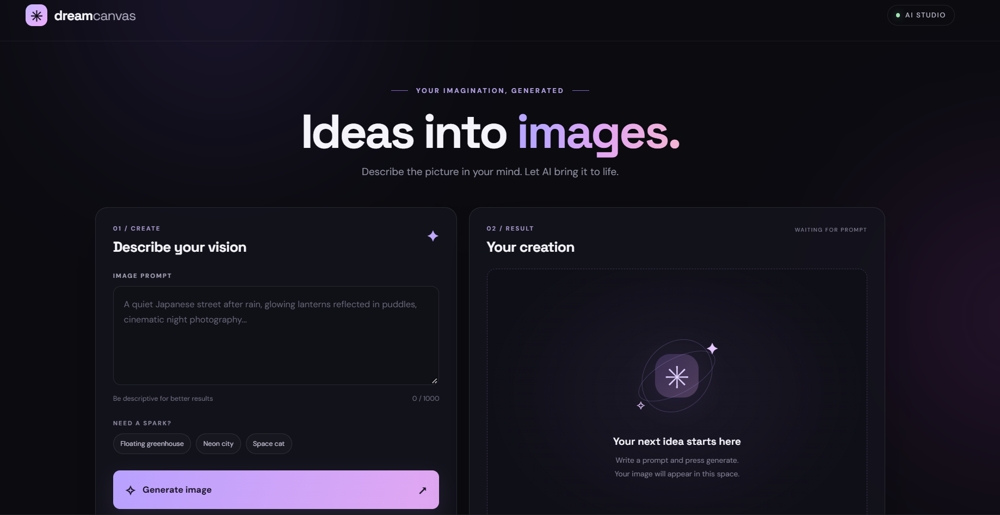
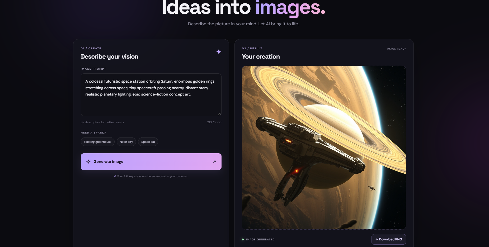

# 🎨 DreamCanvas — AI Image Generator

A text-to-image AI web application that transforms natural-language prompts into images using **FLUX.1-schnell** through Cloudflare Workers AI.

DreamCanvas provides a simple, user-friendly interface where users can describe an image, generate it using generative AI, preview the result, and download the generated image.

## ✨ Features

- **Text-to-Image Generation:** Create images from text prompts.
- **Generative AI Integration:** Uses FLUX.1-schnell through Cloudflare Workers AI.
- **Simple User Interface:** Enter prompts through a clean web interface.
- **Image Preview:** View generated images in the application.
- **Image Download:** Download generated images.
- **Secure Configuration:** Store API credentials in environment variables instead of hardcoding them in source code.

## 🛠️ Tech Stack

| Technology | Purpose |
|---|---|
| Python | Backend programming |
| Flask | Web application framework |
| HTML5 | Web page structure |
| CSS3 | Interface styling |
| JavaScript | Frontend interactions |
| Cloudflare Workers AI | AI inference service |
| FLUX.1-schnell | Text-to-image generation model |
| Git & GitHub | Version control and project hosting |

## 🏗️ System Architecture

```text
        User
         |
         v
  Text Prompt Input
         |
         v
 HTML / CSS / JavaScript
         |
         v
     Flask Backend
         |
         v
  Cloudflare Workers AI
         |
         v
   FLUX.1-schnell Model
         |
         v
   Generated Image
         |
         v
  Preview and Download
```

## 📂 Project Structure

```text
DreamCanvas-AI-Image-Generator/
│
├── app.py
├── requirements.txt
├── README.md
├── .gitignore
├── .env.example
│
├── static/
│   ├── script.js
│   └── style.css
│
└── templates/
    └── index.html
```

## ⚙️ Installation and Setup

### Prerequisites

- Python installed on your computer
- Git
- A Cloudflare account with access to Workers AI
- A Cloudflare API token with the required permissions

### 1. Clone the repository

```bash
git clone https://github.com/somasiddardha/DreamCanvas-AI-Image-Generator.git
```

### 2. Open the project folder

```bash
cd DreamCanvas-AI-Image-Generator
```

### 3. Create a virtual environment

**Windows PowerShell:**

```powershell
python -m venv .venv
```

Activate it:

```powershell
.\.venv\Scripts\Activate.ps1
```

### 4. Install dependencies

```bash
python -m pip install -r requirements.txt
```

### 5. Configure environment variables

Create a local `.env` file in the project root. Use `.env.example` as a reference for the variable names expected by the application.

Add your own Cloudflare credentials using the exact variable names expected by `app.py`.

**Never commit your real `.env` file or publish your API token.**

### 6. Run the application

```bash
python app.py
```

Open the local URL printed in your terminal, typically:

```text
http://127.0.0.1:5000
```

## 🖼️ Screenshots
## Screenshots

### Home Page


### Generated Image


## 🔐 Security

- Keep API tokens and credentials in a local `.env` file.
- Exclude `.env` and `.venv/` using `.gitignore`.
- Use placeholder values in `.env.example`.
- Never publish API tokens, passwords, or other secrets in source code or screenshots.
- Rotate any API token that may have been exposed.

## 🎯 Learning Outcomes

This project demonstrates practical experience with:

- Python web application development using Flask
- Frontend development with HTML, CSS, and JavaScript
- Integration with a generative AI inference API
- Environment-based configuration
- Git and GitHub version control
- Building a text-to-image AI application

## 🚀 Future Enhancements

- Prompt history and saved generations
- Additional image-generation settings
- Multiple image styles and aspect ratios
- Improved error handling and loading indicators
- Deployment to a public hosting platform

## 👨‍💻 Author

**Soma Siddardha**

B.Tech — Computer Science and Engineering (AI & ML)

GitHub: [@somasiddardha](https://github.com/somasiddardha)

## 📄 License

No license has been added to this repository yet. Usage and redistribution rights remain subject to applicable law until a license is selected.